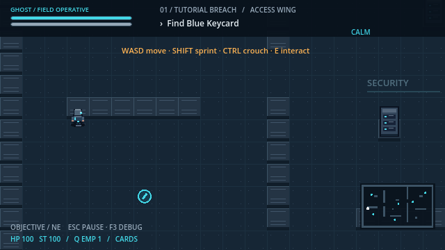
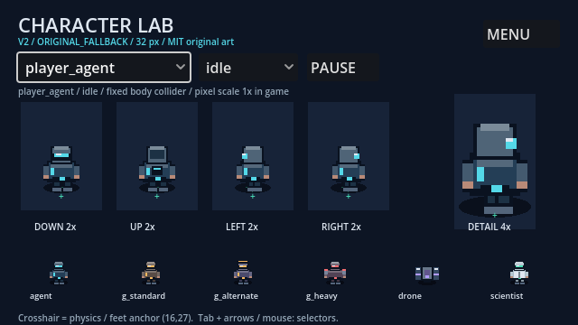
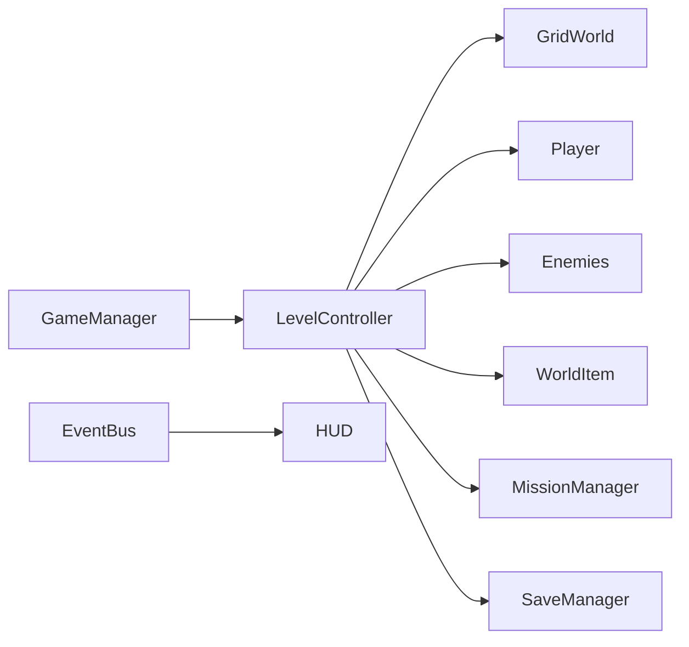
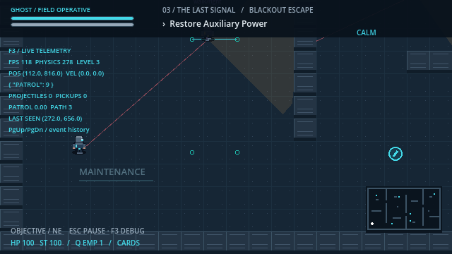

# Shadow Protocol: Blacksite Breach

A native Godot stealth-action game: recover classified research, break security, and escape three authored blacksite sectors.



Eight-way movement, crouch/sprint, guards with eight-state AI, wall-blocked vision and hearing, heavy guards, sweeping cameras and drones. Keycards, cancelable terminal hacks, stun baton, EMP, objective dependencies, checkpoint saves, mission grades and a live F3 developer overlay. V2 adds six original 32px pixel characters, four-direction SpriteFrames, independent CharacterVisual profiles, damage/KO/stun overlays, fixed feet pivots, server foreground Y sorting and an interactive character lab. Synthesized audio and all assets run offline with zero downloads.

**VISUAL_MODE=ORIGINAL_FALLBACK.** Neither Riclmbr nor MurphysDad ZIP was supplied. Included art is original MIT work. No premium or vendor-animation claim.



Three compact missions are implemented. Automated known-route completion takes roughly 3–4 simulated minutes; the requested 15–25-minute blind human experience has not been measured. Native desktop playthrough has completed all three missions, including death/checkpoint retry. Target-device tuning and blind play duration remain review tasks.

## Play

Local macOS/Windows/Linux exports and their actual verification state are recorded in [IMPLEMENTATION_STATUS.md](IMPLEMENTATION_STATUS.md). Download V2 desktop builds, source ZIP and SHA-256 checksums from [Releases](https://github.com/james1507/shadow-protocol/releases/tag/v2.0.0). Local copies remain under ignored `builds/v2/`. No gameplay video is included.

On this Mac, unpack `builds/v2/macos/ShadowProtocol-v2.zip`, open the extracted app. The local build uses ad-hoc signing and is not notarized for public distribution. Source remains editable in Godot.

## Run from source

Install **Godot 4.7.2 stable Standard**, no .NET required: [official archive](https://godotengine.org/download/archive/4.7.2-stable/).

1. Open Godot Project Manager, Import this folder's `project.godot`.
2. Wait for import, press F5. Choose **New Operation**; Continue appears only for a valid save.
3. F6 on `scenes/dev/character_showcase.tscn` opens the 2x/4x character lab; select actor/action. The source main menu also provides CHARACTER LAB.
4. F6 on `scenes/levels/test_arena.tscn` runs isolated developer arena.

Or from terminal in this folder:

```sh
godot --version
godot --headless --path . --editor --import
godot --path .
```

Engine installed for this workspace on the current Mac:

```sh
/Users/cmc-macmini/.local/share/shadow-protocol/Godot.app/Contents/MacOS/Godot --path /Users/cmc-macmini/projects/shadow-protocol
```

Windows/Linux source setup uses the same Godot version and Import/F5 steps. Native builds require matching official export templates; `export_presets.cfg` supplies all three desktop presets. No Python runtime is used by gameplay.

## Controls

| Input | Action |
|---|---|
| WASD / arrows | Move |
| Hold Shift / Ctrl | Sprint / crouch |
| Mouse / left click | Aim / nonlethal stun baton |
| E / Q | Interact / EMP |
| Esc | Pause / resume |
| R when down | Retry checkpoint |
| Enter / Space / Tab / arrows | Native menu navigation |
| F3 / PageUp / PageDown | Debug telemetry / event history |
| F4 in debug arena | Cycle 10/20/40 agents |

Stay close and avoid damage during a three-second hack. EMP disables machines for five seconds; heavy guards resist it. Complete every objective before extraction. Finale has a 90-second escape window; checkpoint retry restores a full timer.

## Tech and architecture

GDScript, CharacterBody2D, real TileMapLayer collision, Area2D interactions, direct physics raycasts, Resources, signals, FileAccess JSON and ConfigFile settings. Production AI uses AStarGrid2D fallback for dynamic doors; NavigationAgent2D actively drives the heavy guard in the arena's dedicated region.



Details: [architecture](docs/ARCHITECTURE.md), [gameplay](docs/GAMEPLAY_SYSTEMS.md), [authored maps](docs/LEVEL_DESIGN.md).

## Debugging and performance



F3 exposes real FPS, position/velocity, state counts, nearest detection/path/last-seen, projectiles, items and bounded event history. Rays/cones clip against physical walls. Reproducible workflows cover FSMs, wall perception, door navigation, stress profiling and adding a terminal.

V2 graphical 10/20/40-guard measurements on M2 Pro are recorded in [raw timings](docs/v2-benchmark.json) and [art QA](docs/ART_QA_REPORT.md). Process-frame cadence is not a display-refresh measurement. No V1 speedup claim. M1 and long-duration frame pacing remain unmeasured.

## Tests

```sh
GODOT=godot tools/validate_project.sh
# Focused suite:
godot --headless --path . --script res://tests/run_tests.gd
# Character resource/state/reload checks:
godot --headless --path . --script res://tests/character_visual_tests.gd
# Physical input-driven campaign with active AI:
godot --headless --path . --script res://tests/playthrough.gd
# Asset trust-boundary checks:
python3 tests/test_asset_tools.py
```

Current local results: **35 gameplay + 14 Godot art checks**, **9 original + 5 character-intake Python checks**, and **3/3 campaign missions**. ART gates: 20 PASS, 0 FAIL, 2 BLOCKED (optional real premium/free integration). Detailed acceptance status: [art QA](docs/ART_QA_REPORT.md) and IMPLEMENTATION_STATUS.md. Tests use isolated save files. Local validation includes clean Git clone import, art checks, menu startup, scene integration and a real three-mission playthrough; hosted CI has not been run. [Test plan](docs/TEST_PLAN.md).

## Project map

- `scenes/` reusable player/enemies/interactables/menus and four authored level roots.
- `scripts/` cross-scene services, components, gameplay, world, HUD and debug drawing.
- `config/balance/` player/enemy Resource tuning; `data/missions/` authored JSON.
- `tools/` safe asset intake, validation, capture, profiling and exports.
- `tests/` zero-dependency Godot/Python checks and campaign driver.
- `docs/` architecture, maps, real screenshots, QA, engineering workflows and measured performance.

## Assets and license

Code, original pixel sprites/geometry, generated tiles, icon and synthesized sounds: [MIT](LICENSE). Godot's built-in font and runtime remain under engine/dependency licenses. No external art, fonts or audio packs adopted.

Optional assets: put official ZIPs in `incoming_assets/`, run inventory, review licenses and exact files, fill `config/asset_mapping.json`, then prepare. Each mapping requires `reviewed: true`, `license_id: "CC0-1.0"`, exact source/destination/usage and SHA-256. Optional frame dimensions use the first verified frame only; no guessed animation slicing. Missing/unverified mapping retains native fallback. [V2 Vietnamese guide](ASSET_SETUP_GUIDE_V2_VI.md), [license audit](docs/ASSET_LICENSE_AUDIT.md), [art bible](docs/CHARACTER_ART_BIBLE.md), [animation matrix](docs/CHARACTER_ANIMATION_MATRIX.csv), [publisher links](docs/ASSET_SOURCES.md).

```sh
python3 tools/inspect_character_pack.py --inventory
python3 tools/asset_inventory.py
python3 tools/prepare_assets.py --mapping config/asset_mapping.json
```

## Development notes

AI-assisted implementation with Codex. Actual bug fixes and test-driver defects are recorded in [case studies](docs/DEBUGGING_CASE_STUDIES.md), without invented incidents or benchmark deltas. Documentation describes the implemented tree rather than a speculative architecture. Remaining release checks: blind play duration, subjective art/audio/balance review, target M1 profiling, hosted CI, Windows/Linux execution and public signing/notarization. Repository: [james1507/shadow-protocol](https://github.com/james1507/shadow-protocol). Release target: [v2.0.0](https://github.com/james1507/shadow-protocol/releases/tag/v2.0.0). Verification details and limitations remain in IMPLEMENTATION_STATUS.md.
