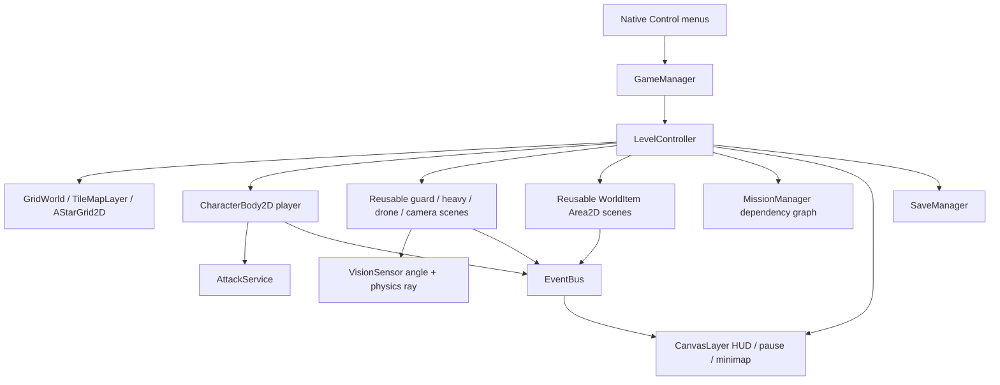

# Architecture

Godot 4.7.2 Standard / GDScript / Compatibility renderer. Gameplay has no Python, browser, network or cloud dependency. Python 3 is only used for developer asset tooling.

## Ownership

Five autoloads own cross-scene concerns: GameManager (flow/results), SaveManager (validated atomic JSON), SettingsManager (ConfigFile), AudioManager (bounded one-shot synthesized WAV playback), EventBus (signals + 50-event ring). Level owns every spatial actor. Reload frees the entire level, automatically removing signal listeners bound to its nodes. Tests use separate save filenames.

PlayerController owns movement/aim/inventory; HealthComponent owns health/death/immunity; StaminaComponent owns fractional recovery timing. ActorStats and EnemyConfig Resources hold tuning. WorldItem convention is `can_interact`, `get_interaction_label`, `interact`. Actual public interactions enforce life, pause, distance, LOS and prerequisite checks. AttackService deduplicates targets per swing.

Levels are .tscn instances of LevelController with an authored level_id. Their geometry, patrols, zones, objects and dependency graph live in data/missions/*.json. GridWorld builds real TileMapLayer floor/wall tiles and tile physics polygons. Original visual code draws actors/items. Optional reviewed texture mappings use AssetLibrary; missing files keep native geometry.

## Collision matrix

| Layer | Bit | Users | Mask / purpose |
|---|---:|---|---|
| WORLD_SOLID | 1 | TileMapLayer walls, closed door StaticBody2D | Blocks moving actors and rays |
| PLAYER | 2 | Player CharacterBody2D | Mask 1 |
| ENEMY | 4 | Guard/heavy/drone/camera | Mask 1; actors do not body-block each other |
| PLAYER_ATTACK | 8 | Reserved named layer | Baton uses range/angle + ray service, no overlapping damage area |
| ENEMY_ATTACK | 16 | Reserved named layer | Melee uses range + ray service |
| INTERACTABLE | 32 | WorldItem Area2D | Mask 2; never solid |
| SENSOR | 64 | Reserved named layer | Vision broadphase is distance, narrowphase angle + ray |
| PROJECTILE | 128 | EnemyProjectile CharacterBody2D | Mask 3 (world + player) |

This implementation deliberately uses direct physics queries for combat/perception rather than unused hurtbox/hitbox wrapper nodes. Attack code checks actual line of sight at impact. Drone projectiles use swept move_and_collide, expire after two seconds and free on impact.

## Navigation choice

Production uses documented AStarGrid2D fallback permitted by spec for dynamic doors. Closed doors mark their exact two-cell collider footprint solid; opening disables physics and clears both AStar cells. Routes update every 0.25 seconds. CharacterBody2D still resolves collisions, including blocked destinations. Stuck detection schedules one route recovery; no teleporting.

Every enemy scene includes NavigationAgent2D. In test_arena, the heavy guard actively follows NavigationAgent2D in `NavigationAgentDemoRegion`, a rectangular right-hand room without dynamic door crossings. T26 queries a real server-generated route. The production fallback is not presented as dynamically rebaked NavigationAgent navigation.

## Persistence boundaries

SaveManager validates version/types/finite values, map bounds/walls/cover, mission IDs/prerequisites, door/pickup IDs and result statistics before application. Temp write + flush + same-filesystem rename replaces the old save only after successful write. Corrupt/future-version input is rejected, preserved and copied to an `.invalid-*` backup. Continue is disabled for invalid save data. Level validates again before restore. Retry restores checkpoint state with fresh enemies and spawn grace; finale timer resets to 90 seconds.

Settings are independent from mission saves. UI pause runs PROCESS_MODE_ALWAYS; world simulation inherits paused processing. Debug drawing is gated by OS.is_debug_build(). Release excludes arena/test/tool/docs content.

## V2 visuals

Player/Guard/Heavy/Drone instantiate CharacterVisual. Registry resolves semantic actor keys to immutable shared CharacterVisualProfile/SpriteFrames resources; JSON roster is included in exports. Each instance owns playback/action/status state only. Player damage signal and AttackService/FSM trigger presentation, never animation-derived damage. Timed stun, save schema and collider transforms remain V1. Root/world/enemy/interactable Y sorting lets original server props occlude actors by feet. Ground and solid walls render behind, preserving collision/nav geometry. See CHARACTER_ART_BIBLE.md for exact region/pivot/fallback policy.
