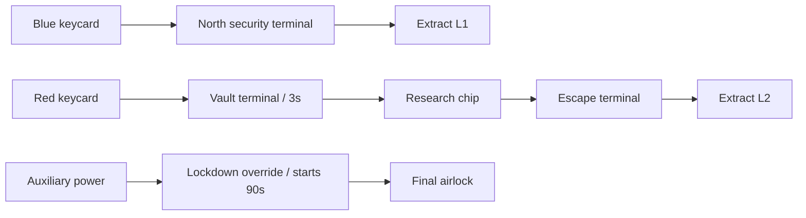

# Authored level design

All coordinates below are logical 32px cells, origin top-left. Exact wall segments, cover, patrols and actor coordinates live in JSON; geometry is deterministic. The minimap shows the actual grid and current player location.

```text
01 ACCESS WING / 40 x 24
+----------------------+-----------------+
| NW card [5,5] | office| EXIT [35,4]     |
|              |       | camera         |
|              gap     door [25,8]      |
|---- cover ---| security [20,10]        |
| storage EMP  | patrol| second patrol  |
| SPAWN [3,19] | health| lower bypass   |
+---------------------------------------+

02 RESEARCH VAULT / 48 x 30
+--------------+-------------+-----------------+
| Red [7,6]    | research    | Chip [40,5]     |
| cover        | patrol      | heavy / vault   |
|    door [15,11] terminal [24,11]             |
|              |   vault door [29,14]         |
| health       | cover       | escape [39,17] |
| first patrol | EMP [19,25] | EXIT [43,26]   |
| SPAWN [3,25] | hub         | drone shaft    |
+--------------------------------------------+

03 BLACKOUT ESCAPE / 52 x 30
+------------+--------------+-----------+------------+
| Power[6,5] | Override[22,6]| industrial| EXIT[47,4] |
|            |              |           | heavy      |
| door[13,9] | cover        | airlock door[39,12]    |
|            | patrol       | heavy     | drone      |
| tunnel     | EMP[17,25]    | checkpoint[30,18]     |
| SPAWN[3,25]|              | health    |            |
+-------------------------------------------------+
```

Objective graphs:



The map is not randomly generated. Two-cell door openings match 32x64 colliders and two AStar cells. Cover tiles are actual world collision. Patrol paths traverse authored open floors; alternate corridors avoid direct engagement. Level 1 has 2 guards + camera; level 2 has 3 guards + heavy + drone + 2 cameras; finale has 3 guards + 2 heavies + 2 drones + 2 cameras.

## Verified automated route

`tests/playthrough.gd` starts from New Game and injects normal movement/interact/gadget actions. It follows physical AStar waypoints, uses available EMP, and completes all three missions with active enemy AI. It never teleports, mutates mission completion or grants health/ammunition. It runs at 4x simulation time for developer turnaround. Capture logs distinguish this from manual human playtesting.

- L1: Blue card → security console → north door → exit.
- L2: Red card → lab door → vault console → chip → storage EMP → escape console → exit.
- L3: Power → EMP → override → exit.

Unit reachability audit additionally opens doors and checks routes from spawn to every authored interactable. That audit alone is not the completion proof; the input-driven playthrough exercises actual prerequisites and collision.

A known-route automated run takes roughly 3–4 simulated minutes. Blind human 15–25-minute target remains unmeasured; do not advertise it as achieved.
